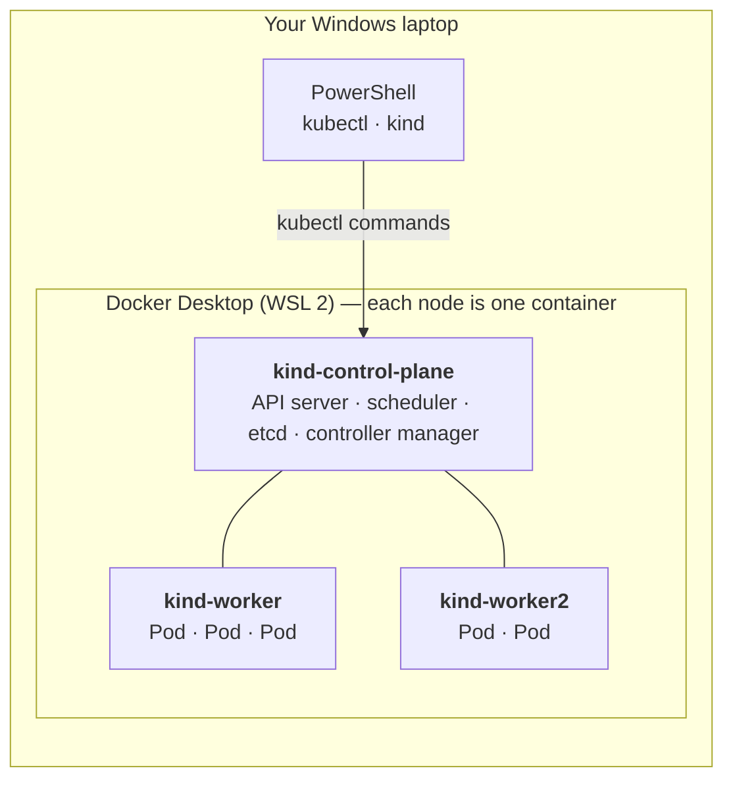
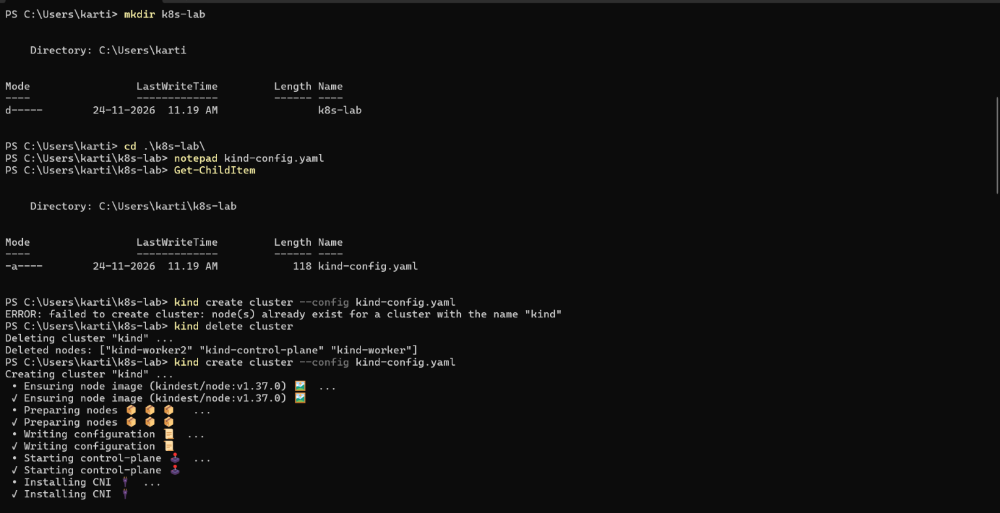
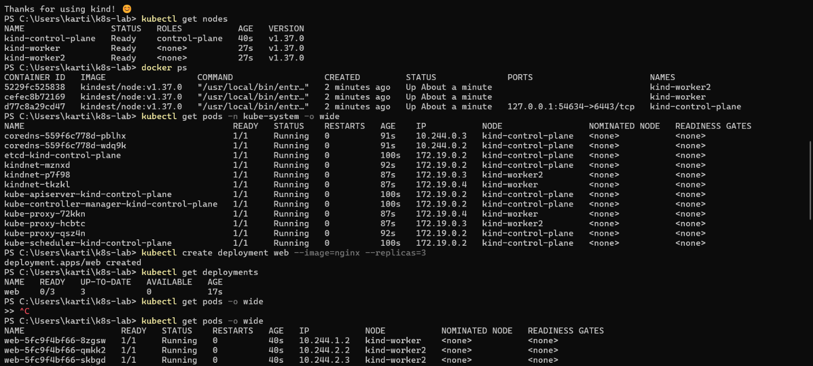
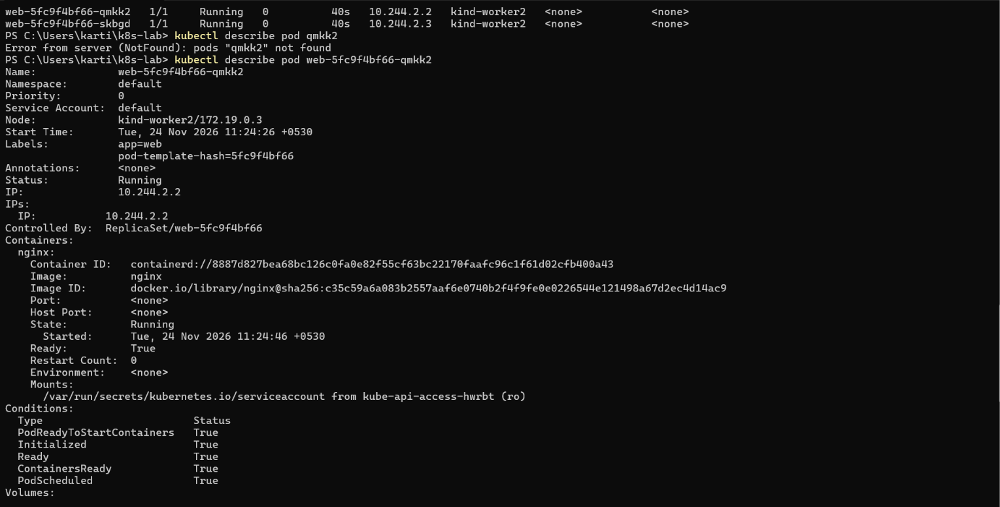
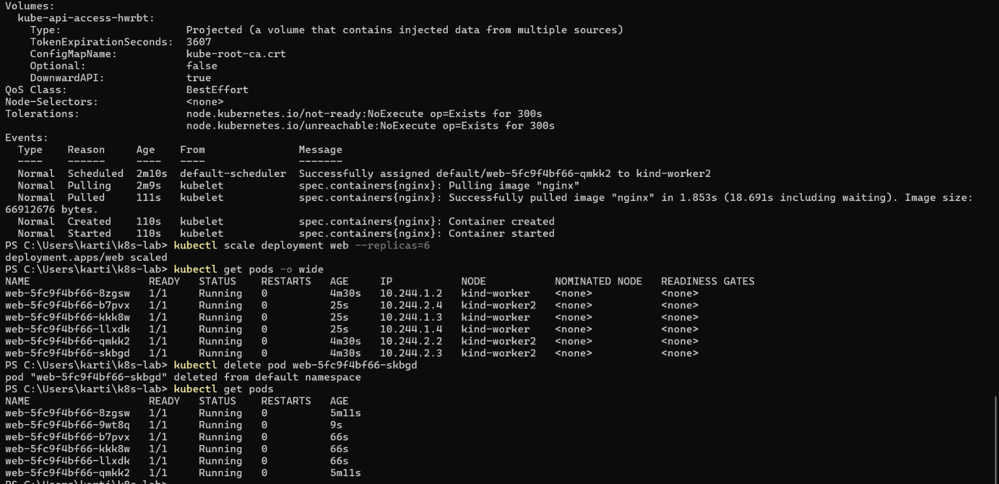

# Kubernetes Lab on Windows

> Build a three-node Kubernetes cluster on your own laptop, deploy an NGINX web app, then scale it and watch Kubernetes heal itself.


**Tech stack:** WSL 2 · Docker Desktop · kubectl · kind v0.33 · NGINX

---

## Table of Contents

1. [Overview](#overview)
2. [Architecture](#architecture)
3. [Before You Begin](#before-you-begin)
4. [Part 1 – Install the Tools](#part-1--install-the-tools)
5. [Part 2 – Check That the Tools Work](#part-2--check-that-the-tools-work)
6. [Part 3 – Create the Cluster Configuration File](#part-3--create-the-cluster-configuration-file)
7. [Part 4 – Build the Three-Node Kubernetes Cluster](#part-4--build-the-three-node-kubernetes-cluster)
8. [Part 5 – Deploy an NGINX Web Application](#part-5--deploy-an-nginx-web-application)
9. [Part 6 – Scale the Pods and Test Self-Healing](#part-6--scale-the-pods-and-test-self-healing)
10. [Results and Observations](#results-and-observations)
11. [Conclusion](#conclusion)
12. [Troubleshooting](#troubleshooting)
13. [Command Quick Reference](#command-quick-reference)
14. [Repository Structure](#repository-structure)

---

## Overview

**Goal:** build a local Kubernetes cluster with one control-plane node and two worker nodes, deploy NGINX, and test scaling and self-healing.

The lab has three main phases:

| Phase | What you do |
|-------|-------------|
| **1. Build** | Create a cluster with 1 control plane and 2 workers |
| **2. Deploy** | Run three NGINX Pods and see where they run |
| **3. Scale and heal** | Go to six Pods and watch a deleted one come back |

### The lab at a glance

| Part | Title | What happens | Time |
|------|-------|--------------|------|
| 1 | Install the tools | WSL 2, Docker Desktop, kubectl, kind | 20 min |
| 2 | Check the tools | Make sure each one runs | 5 min |
| 3 | Write the config file | Describe a 3-node cluster | 5 min |
| 4 | Build the cluster | Create it and check it is Ready | 10 min |
| 5 | Deploy NGINX | Run 3 Pods and see where they land | 10 min |
| 6 | Scale and self-heal | Go to 6 Pods, delete one, watch it return | 10 min |

---

## Architecture

Every Kubernetes "node" in this lab is a **Docker container** running on Docker Desktop (WSL 2). You control the cluster from PowerShell using `kubectl` (to talk to the cluster) and `kind` (to create it).

```
┌─────────────────────────── Your Windows laptop ───────────────────────────┐
│                                                                           │
│  ┌──────────────┐      ┌──────── Docker Desktop (WSL 2) ───────────────┐  │
│  │  PowerShell  │      │         each node is one container            │  │
│  │              │      │                                               │  │
│  │ kubectl·kind │ ───► │  ┌─────────────────────────────────────────┐  │  │
│  └──────────────┘      │  │           kind-control-plane            │  │  │
│                        │  │ API server · scheduler · etcd · ctrl mgr│  │  │
│                        │  └───────────────┬─────────────┬───────────┘  │  │
│                        │                  │             │              │  │
│                        │        ┌─────────▼───┐   ┌─────▼────────┐     │  │
│                        │        │ kind-worker │   │ kind-worker2 │     │  │
│                        │        │ [Pod] [Pod] │   │ [Pod] [Pod]  │     │  │
│                        │        │ [Pod]       │   │              │     │  │
│                        │        └─────────────┘   └──────────────┘     │  │
│                        └───────────────────────────────────────────────┘  │
└───────────────────────────────────────────────────────────────────────────┘
```

The same architecture as a diagram (rendered automatically by GitHub):



| Component | Role |
|-----------|------|
| **kind-control-plane** | The cluster's brain: runs the API server, scheduler, etcd and controller manager. Stores the state and decides where work goes. |
| **kind-worker / kind-worker2** | The muscles: the nodes where your application Pods run. |
| **kube-proxy** | Runs as a Pod on every node to handle networking. |
| **kubectl** | Command-line tool used to control Kubernetes. |
| **kind** (Kubernetes IN Docker) | Creates a Kubernetes cluster using Docker containers. |

---

## Before You Begin

### Check your laptop

- [ ] Windows 10 or 11, 64-bit
- [ ] Internet access (about 2 GB to download)
- [ ] Administrator permission to install software
- [ ] 8 GB RAM at least (16 GB recommended)
- [ ] PowerShell (**not** Git Bash)

### How to use this manual

- Work through the steps in order. Copy one command at a time into PowerShell and press Enter.
- Read **What it does** before you run each command.
- Compare your screen with **You should see** before moving on.
- Replace anything in `<angle brackets>` with a real name, without the brackets.

---

## Part 1 – Install the Tools

*About 20 min.* You need four tools: **WSL 2** (the Linux layer), **Docker Desktop** (runs the nodes), **kubectl** (talks to the cluster) and **kind** (creates the cluster).

### 1.1 Install WSL 2

Run PowerShell **as Administrator**:

```powershell
wsl --install
```

- **What it does:** Installs Windows Subsystem for Linux (WSL 2), which Docker Desktop runs on.
- **You should see:** Download and install progress, then a request to restart. **Restart Windows** when asked.

### 1.2 Install Docker Desktop

1. Download **Docker Desktop for Windows** from [docker.com/products/docker-desktop](https://www.docker.com/products/docker-desktop).
2. Run the installer and keep **"Use WSL 2 instead of Hyper-V"** ticked.
3. Open **Docker Desktop** from the Start menu and accept the terms.

- **What it does:** Installs Docker, which will run each Kubernetes node as a container. This step uses the installer, not a PowerShell command.
- **You should see:** Docker Desktop's status shows **Engine running**.

> ⚠️ **Important:** If Docker Desktop says WSL 2 or virtualization is missing, finish the WSL setup and restart Windows. If needed, turn on CPU virtualization (Intel VT-x or AMD-V/SVM) in your BIOS/UEFI settings.

### 1.3 Install kubectl

```powershell
winget install -e --id Kubernetes.kubectl
```

- **What it does:** Installs `kubectl`, the command-line tool used to control Kubernetes.
- **You should see:** `Successfully installed` at the end.

> 💡 **First time using winget?** It may ask you to accept the source agreements. Type `Y` and press Enter.

### 1.4 Install kind

```powershell
winget install -e --id Kubernetes.kind
```

- **What it does:** Installs `kind` (Kubernetes IN Docker), which creates a Kubernetes cluster using Docker containers.
- **You should see:** `Successfully installed` at the end.

### 1.5 Reopen PowerShell

```powershell
exit
```

- **What it does:** Closes this PowerShell window. Open a new one so it can find the tools you just installed.

---

## Part 2 – Check That the Tools Work

*About 5 min.* Open Docker Desktop and wait until the Engine is running. Then, in a **new** PowerShell window, run these commands one by one.

### 2.1 Check Docker

```powershell
docker version
```

- **What it does:** Shows the versions of Docker's client and server.
- **You should see:** Both a **Client** section and a **Server** section. If the Server part shows an error, Docker Desktop is not running yet.

### 2.2 Test a container

```powershell
docker run hello-world
```

- **What it does:** Downloads and runs a tiny test container.
- **You should see:** (sample output)

```text
Hello from Docker!
This message shows that your installation appears to be working correctly.
```

### 2.3 Check kubectl

```powershell
kubectl version --client
```

- **What it does:** Shows the installed kubectl version.
- **You should see:** (sample output)

```text
Client Version: v1.37.x
Kustomize Version: v5.x.x
```

### 2.4 Check kind

```powershell
kind version
```

- **What it does:** Shows the installed kind version.
- **You should see:** (sample output)

```text
kind v0.33.0 go1.26.x windows/amd64
```

---

## Part 3 – Create the Cluster Configuration File

*About 5 min.* A short file tells kind to build one control-plane node and two worker nodes instead of a single node.

### 3.1 Create a lab folder

```powershell
mkdir k8s-lab
```

- **What it does:** Creates a folder to keep the lab files in. If it already exists, just continue.

### 3.2 Enter the folder

```powershell
cd k8s-lab
```

- **What it does:** Moves PowerShell into the lab folder. Run all the following commands from here.
- **You should see:** The prompt now ends in `\k8s-lab>`.

### 3.3 Open the configuration file

```powershell
notepad kind-config.yaml
```

- **What it does:** Opens Notepad with a new file called `kind-config.yaml`.
- **You should see:** A question asking whether to create a new file. Click **Yes**.

### 3.4 Paste the configuration and save

1. Copy the content below into Notepad **exactly as shown**.
2. Press `Ctrl + S` to save, then close Notepad.

**`kind-config.yaml`**

```yaml
kind: Cluster
apiVersion: kind.x-k8s.io/v1alpha4
nodes:
  - role: control-plane
  - role: worker
  - role: worker
```

- **What it does:** Asks kind to create three nodes: one control-plane node and two worker nodes.

> ⚠️ **Use spaces, not tabs.** If Notepad offers a *Save as type*, choose **All files** so the file does not become `kind-config.yaml.txt`.

### 3.5 Check that the file exists

```powershell
Get-ChildItem
```

- **What it does:** Lists the files in the current folder.
- **You should see:** `kind-config.yaml` in the Name column.

---

## Part 4 – Build the Three-Node Kubernetes Cluster

*About 10 min.* One command builds the whole cluster. Then you check that all three nodes are healthy and look at what is running inside.

### 4.1 Create the cluster

```powershell
kind create cluster --config kind-config.yaml
```

- **What it does:** Creates the cluster. The first run can take a few minutes while the Kubernetes node image downloads.
- **You should see:** (sample output — the last line is the one that matters)

```text
Creating cluster "kind" ...
 ✓ Ensuring node image (kindest/node:v1.37.0)
 ✓ Preparing nodes
 ✓ Writing configuration
 ✓ Starting control-plane
 ✓ Installing CNI
 ✓ Installing StorageClass
 ✓ Joining worker nodes
Set kubectl context to "kind-kind"
```

📸 **Screenshot – config file and cluster build:**



> **Note from our run:** The first attempt failed with `ERROR: failed to create cluster: node(s) already exist for a cluster with the name "kind"` because an older cluster was present. We removed it with `kind delete cluster` and re-ran the create command, which succeeded.

### 4.2 Check the cluster connection

```powershell
kubectl cluster-info --context kind-kind
```

- **What it does:** Checks that kubectl can talk to the new cluster.
- **You should see:** (sample output)

```text
Kubernetes control plane is running at https://127.0.0.1:<port>
CoreDNS is running at https://127.0.0.1:<port>/api/v1/...
```

### 4.3 Check node status

```powershell
kubectl get nodes
```

- **What it does:** Lists the control-plane node and the two worker nodes.
- **You should see:** Three nodes with STATUS **Ready**. If one is still starting, wait a minute and run it again.

```text
NAME                 STATUS   ROLES           AGE    VERSION
kind-control-plane   Ready    control-plane   2m     v1.37.0
kind-worker          Ready    <none>          90s    v1.37.0
kind-worker2         Ready    <none>          90s    v1.37.0
```

### 4.4 Check the Docker containers

```powershell
docker ps
```

- **What it does:** Shows the running Docker containers. Each one is a kind node.
- **You should see:** Three containers named `kind-control-plane`, `kind-worker` and `kind-worker2` in the NAMES column.

### 4.5 Check the Kubernetes system Pods

```powershell
kubectl get pods -n kube-system -o wide
```

- **What it does:** Lists Kubernetes' own components, such as the API server and the scheduler.
- **You should see:** Pods such as `etcd`, `kube-apiserver`, `kube-scheduler` and `kube-controller-manager` on `kind-control-plane`, and a `kube-proxy` Pod on every node. Some may need a little time to show Running.

📸 **Screenshot – verify nodes, containers and system Pods:**



> **What just happened?** The control-plane node is the cluster's brain: it stores the state and decides where work goes. The two workers are the muscles where your apps will run. All three are Docker containers on your laptop.

---

## Part 5 – Deploy an NGINX Web Application

*About 10 min.* Now ask Kubernetes to run a real app: three copies of the NGINX web server, spread over the workers.

### 5.1 Create three NGINX replicas

```powershell
kubectl create deployment web --image=nginx --replicas=3
```

- **What it does:** Creates a Deployment named `web` and asks Kubernetes to run three copies (Pods) of the NGINX web server.
- **You should see:** `deployment.apps/web created`

### 5.2 Check the Deployment

```powershell
kubectl get deployments
```

- **What it does:** Shows how many replicas you asked for and how many are ready.
- **You should see:** Wait until READY shows **3/3**.

```text
NAME   READY   UP-TO-DATE   AVAILABLE   AGE
web    3/3     3            3           45s
```

> In our run the Deployment first showed `0/3` (17s old) while the NGINX image was being pulled, then became ready shortly after.

### 5.3 See where the Pods are running

```powershell
kubectl get pods -o wide
```

- **What it does:** Lists the three Pods and the node each one was placed on.
- **You should see:** Look at the NODE column: the Pods are spread over `kind-worker` and `kind-worker2`.

### 5.4 Inspect a Pod *(optional)*

```powershell
kubectl describe pod <pod-name>
```

- **What it does:** Shows the details and history of one Pod. Replace `<pod-name>` with a real name copied from Step 5.3, without the angle brackets.
- **You should see:** Under **Events** at the bottom, a line like `Successfully assigned default/web-… to kind-worker`. That is the Scheduler's decision.

> **Tip – copying a Pod name:** select it with the mouse, press `Ctrl + C` (or right-click), then paste it into your command with `Ctrl + V`.
> In our run, `kubectl describe pod qmkk2` failed with `Error from server (NotFound)`, because the **full** Pod name (`web-5fc9f4bf66-qmkk2`) is required.

📸 **Screenshot – inspecting the NGINX Pod:**



---

## Part 6 – Scale the Pods and Test Self-Healing

*About 10 min.* Change how many copies you want, then delete one on purpose and watch Kubernetes put it back without being asked.

### 6.1 Scale from three Pods to six

```powershell
kubectl scale deployment web --replicas=6
```

- **What it does:** Changes the desired number of NGINX Pods from three to six.
- **You should see:** `deployment.apps/web scaled`

### 6.2 Check the six Pods

```powershell
kubectl get pods -o wide
```

- **What it does:** Shows all the Pods and the node each one was placed on.
- **You should see:** Six `web` Pods with STATUS **Running**, shared between the two workers.

> 👀 **Watch it happen live:** run `kubectl get pods -w` in a second PowerShell window before Step 6.3. Press `Ctrl + C` to stop watching.

### 6.3 Delete one Pod for the test

```powershell
kubectl delete pod <pod-name>
```

- **What it does:** Deletes one Pod on purpose. Replace `<pod-name>` with a real `web` Pod name from Step 6.2.
- **You should see:** A line confirming that the Pod was deleted.

### 6.4 Confirm self-healing

```powershell
kubectl get pods
```

- **What it does:** Checks that Kubernetes created a replacement Pod to bring the Deployment back to six replicas.
- **You should see:** Six Pods again. The replacement has a new name and an AGE of only a few seconds.

📸 **Screenshot – scaling to 6 replicas and self-healing:**



---

## Results and Observations

Results recorded from our run (Kubernetes `v1.37.0`, cluster name `kind`).

### Cluster

| Node | Role | Status | Version |
|------|------|--------|---------|
| `kind-control-plane` | control-plane | Ready | v1.37.0 |
| `kind-worker` | worker | Ready | v1.37.0 |
| `kind-worker2` | worker | Ready | v1.37.0 |

Each node ran as a `kindest/node:v1.37.0` Docker container; the control-plane container exposed the API server on `127.0.0.1:54634 → 6443/tcp`. The `kube-system` namespace contained `coredns` (×2), `etcd`, `kube-apiserver`, `kube-controller-manager`, `kube-scheduler`, `kindnet` (×2 workers) and `kube-proxy` (×3, one per node).

### Pod placement – 3 replicas (Step 5.3)

| Pod | Node |
|-----|------|
| `web-5fc9f4bf66-8zgsw` | kind-worker |
| `web-5fc9f4bf66-qmkk2` | kind-worker2 |
| `web-5fc9f4bf66-skbgd` | kind-worker2 |

**Record:** Pods on `kind-worker` = **1** · Pods on `kind-worker2` = **2**

### Pod placement – 6 replicas (Step 6.2)

| Pod | Node |
|-----|------|
| `web-5fc9f4bf66-8zgsw` | kind-worker |
| `web-5fc9f4bf66-kkk8w` | kind-worker |
| `web-5fc9f4bf66-llxdk` | kind-worker |
| `web-5fc9f4bf66-b7pvx` | kind-worker2 |
| `web-5fc9f4bf66-qmkk2` | kind-worker2 |
| `web-5fc9f4bf66-skbgd` | kind-worker2 |

**Record:** Pods on `kind-worker` = **3** · Pods on `kind-worker2` = **3**

### Scheduler decision (Step 5.4)

The `describe` output for `web-5fc9f4bf66-qmkk2` showed: `Successfully assigned default/web-5fc9f4bf66-qmkk2 to kind-worker2`, followed by image pull (`nginx`), container created and container started events. The Pod was `Controlled By: ReplicaSet/web-5fc9f4bf66`, with label `app=web`.

### Self-healing test (Steps 6.3 – 6.4)

| Event | Detail |
|-------|--------|
| Pod deleted | `web-5fc9f4bf66-skbgd` |
| Replacement created | `web-5fc9f4bf66-9wt8q` (AGE 9s) |
| Pods running afterwards | 6 / 6 |

---

## Conclusion

In this experiment we successfully:

- **Installed the tools** – WSL 2, Docker Desktop, kubectl and kind on Windows.
- **Built a cluster** – one control-plane node and two worker nodes, all running as Docker containers on a single laptop, and verified all three nodes were `Ready`.
- **Looked inside** – saw the API server, scheduler, etcd, controller manager, CoreDNS and kube-proxy running as Pods in the `kube-system` namespace.
- **Deployed an application** – ran three NGINX Pods through a Deployment and saw how the scheduler placed them across the worker nodes.
- **Scaled and healed** – scaled the Deployment from 3 to 6 replicas with a single command, then deleted a Pod and watched Kubernetes automatically create a replacement to restore the desired state.

The key takeaway is Kubernetes' **declarative, self-healing model**: we declare the *desired state* (for example, "6 replicas of NGINX") and the control plane continuously works to make the *actual state* match it. The Deployment and its ReplicaSet recreated the deleted Pod without any manual intervention, and the scheduler distributed the workload across available nodes. This lab also shows that a realistic multi-node cluster can be run locally for learning and testing using `kind`.

---

## Troubleshooting

| What you see | What to do |
|--------------|------------|
| `Cannot connect to the Docker daemon` or `error during connect` | Docker Desktop isn't running. Open it and wait for **Engine running**. |
| `kubectl` or `kind` is not recognized | Close every PowerShell window and open a new one (Step 1.5). |
| WSL 2 or virtualization missing | Run `wsl --install` as Administrator and restart. Turn on virtualization in BIOS/UEFI. |
| A node stays `NotReady` | Wait 1–2 minutes. Still stuck? Close other apps, run `kind delete cluster`, then repeat Step 4.1. |
| A Pod shows `ImagePullBackOff` | No internet or a typo in the image name. `kubectl describe pod <pod-name>` shows the exact error. |
| `error parsing kind-config.yaml` | The file has tabs or wrong spacing. Re-copy it exactly as shown in Step 3.4. |
| `node(s) already exist for a cluster with the name "kind"` | A cluster with that name already exists. Run `kind delete cluster`, then repeat Step 4.1. |
| `Error from server (NotFound): pods "..." not found` | Use the **full** Pod name from `kubectl get pods`, not a shortened version. |
| Commands hang or behave oddly in Git Bash | Use PowerShell instead. |

### Cleanup (optional)

```powershell
kind delete cluster
```

Removes the cluster and its three node containers.

---

## Command Quick Reference

Every command from Steps 1–6, in the order used.

| Part | Command | What it does |
|------|---------|--------------|
| 1 | `wsl --install` | Install WSL 2 (as Administrator) |
| 1 | `winget install -e --id Kubernetes.kubectl` | Install kubectl |
| 1 | `winget install -e --id Kubernetes.kind` | Install kind |
| 2 | `docker version` | Check Docker client and server |
| 2 | `docker run hello-world` | Test that containers run |
| 2 | `kubectl version --client` | Check kubectl |
| 2 | `kind version` | Check kind |
| 3 | `mkdir k8s-lab` | Make the lab folder |
| 3 | `cd k8s-lab` | Go into the lab folder |
| 3 | `notepad kind-config.yaml` | Create the config file |
| 3 | `Get-ChildItem` | List files in the folder |
| 4 | `kind create cluster --config kind-config.yaml` | Build the 3-node cluster |
| 4 | `kubectl cluster-info --context kind-kind` | Check the connection |
| 4 | `kubectl get nodes` | List nodes and their status |
| 4 | `docker ps` | See the node containers |
| 4 | `kubectl get pods -n kube-system -o wide` | See the system Pods |
| 5 | `kubectl create deployment web --image=nginx --replicas=3` | Run 3 NGINX Pods |
| 5 | `kubectl get deployments` | Check desired vs ready replicas |
| 5 | `kubectl get pods -o wide` | See Pods and their nodes |
| 5 | `kubectl describe pod <pod-name>` | Details and events of one Pod |
| 6 | `kubectl scale deployment web --replicas=6` | Scale to 6 Pods |
| 6 | `kubectl delete pod <pod-name>` | Delete one Pod |
| 6 | `kubectl get pods` | Check the replacement Pod |

---

## Repository Structure

```text
.
├── README.md
├── src/
|   └── kind-config.yaml
└── screenshots/
    ├── 01_Create_Cluster_Config_and_Build_Kind_Cluster.png
    ├── 02_Verify_Nodes_Containers_and_Deploy_NGINX.png
    ├── 03_Inspect_NGINX_Pod_Details.png
    └── 04_Scale_to_6_Replicas_and_Test_Self_Healing.png
```
